# Домашнее задание к занятию 5 "`Практическое применение Docker`" - `Поздникин Евгений`


### Инструкция по выполнению домашнего задания

   1. Сделайте `fork` данного репозитория к себе в Github и переименуйте его по названию или номеру занятия, например, https://github.com/имя-вашего-репозитория/git-hw или  https://github.com/имя-вашего-репозитория/7-1-ansible-hw).
   2. Выполните клонирование данного репозитория к себе на ПК с помощью команды `git clone`.
   3. Выполните домашнее задание и заполните у себя локально этот файл README.md:
      - впишите вверху название занятия и вашу фамилию и имя
      - в каждом задании добавьте решение в требуемом виде (текст/код/скриншоты/ссылка)
      - для корректного добавления скриншотов воспользуйтесь [инструкцией "Как вставить скриншот в шаблон с решением](https://github.com/netology-code/sys-pattern-homework/blob/main/screen-instruction.md)
      - при оформлении используйте возможности языка разметки md (коротко об этом можно посмотреть в [инструкции  по MarkDown](https://github.com/netology-code/sys-pattern-homework/blob/main/md-instruction.md))
   4. После завершения работы над домашним заданием сделайте коммит (`git commit -m "comment"`) и отправьте его на Github (`git push origin`);
   5. В личном кабинете прикрепите и отправьте ссылку на решение в виде md-файла в вашем Github.
   6. Любые вопросы по выполнению заданий спрашивайте в разделе “Вопросы по заданию” в личном кабинете.
   
Желаем успехов в выполнении домашнего задания!
   
### Дополнительные материалы, которые могут быть полезны для выполнения задания

1. [Руководство по оформлению Markdown файлов](https://gist.github.com/Jekins/2bf2d0638163f1294637#Code)

---

### Задание 0
Проверяю нужные версии Docker - `docker version` и `docker compose version`
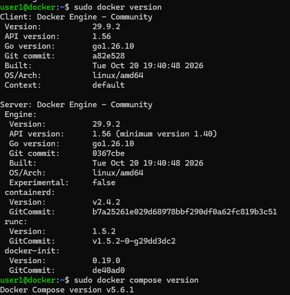
### Задание 1

Содержимое [Dockerfile.python](https://github.com/PozdnikinEugene/05-virt-04-docker-in-practice-fork/blob/main/Dockerfile.python)


```
# Stage 1: Build stage
FROM python:3.12-slim AS builder
WORKDIR /app
COPY requirements.txt .
# Создаем виртуальное окружение и устанавливаем зависимости туда
RUN python -m venv /opt/venv && \
    /opt/venv/bin/pip install --no-cache-dir -r requirements.txt

# Stage 2: Final stage
FROM python:3.12-slim
WORKDIR /app
# Копируем созданное виртуальное окружение целиком
COPY --from=builder /opt/venv /opt/venv
COPY . .
# Добавляем путь к бинарникам venv в PATH, чтобы uvicorn вызывался напрямую
ENV PATH="/opt/venv/bin:$PATH"
CMD ["uvicorn", "main:app", "--host", "0.0.0.0", "--port", "5000"]

Файл [.dockerignore](https://github.com/PozdnikinEugene/05-virt-04-docker-in-practice-fork/blob/main/.dockerignore)
Файл [.gitignore](https://github.com/PozdnikinEugene/05-virt-04-docker-in-practice-fork/blob/main/.gitignore)

```
Сборка контейнера

```
docker build -f Dockerfile.python -t my-python-app:latest .
```
Запуск

```
docker run -d -p 5000:5000 --name my-python-container my-python-app:latest
```
Проверка 
```
docker logs my-python-container
```
Вывод консоли

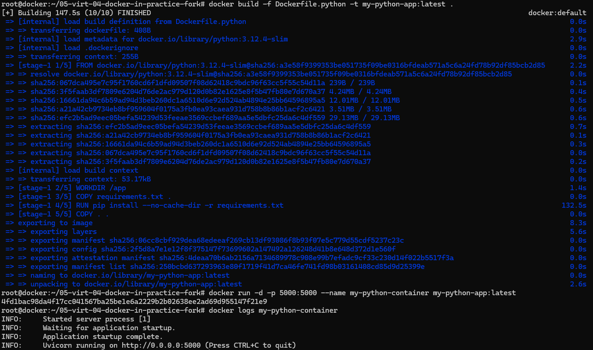


---

### Задание 3
Файл [compose.yaml](https://github.com/PozdnikinEugene/05-virt-04-docker-in-practice-fork/blob/main/compose.yaml)
Запускаю проект 

```
docker compose up -d
```

Делаю 

```
curl -L http://127.0.0.1:8090
```
Проект поднялся и отвечает на запрос

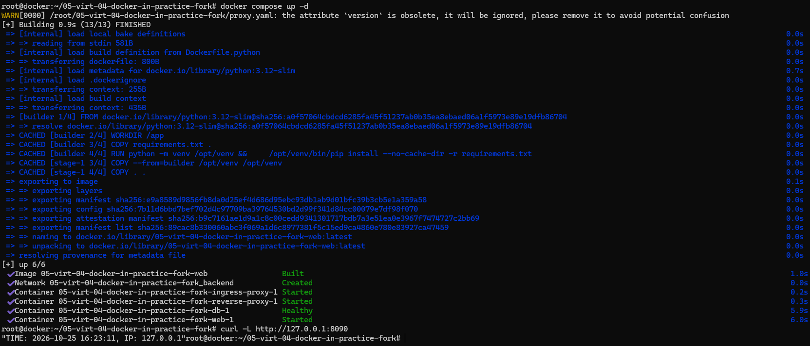

Захожу в контейнер DB. Для безопасности пароль не ввожу и оставляю пустое `-p` для того что бы он его запросил 

```
docker exec -ti 05-virt-04-docker-in-practice-fork-db-1 mysql -uroot -p
```
Выполняю требуемые запросы 

```
mysql> show databases;
mysql> use virtd;
mysql> show tables; SELECT * from requests LIMIT 10;
```

Останавливаю проект

```
docker compose down
```
Вывод консоли

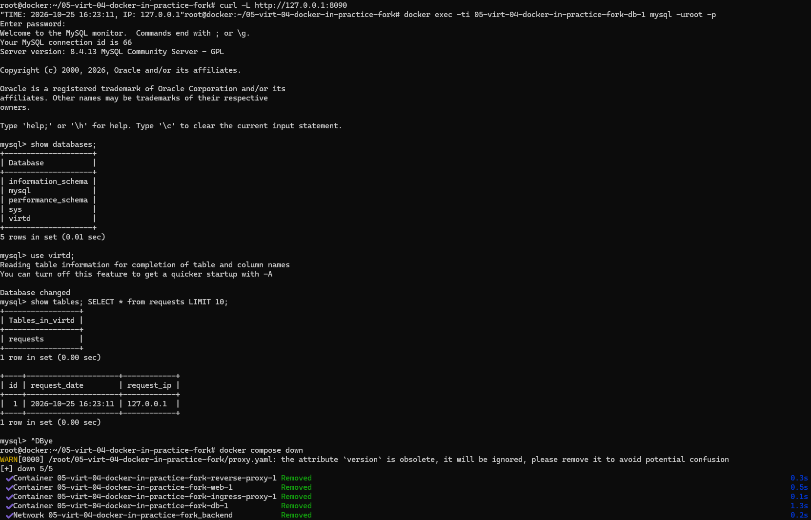

---

### Задание 4
Создаю ВМ в YC
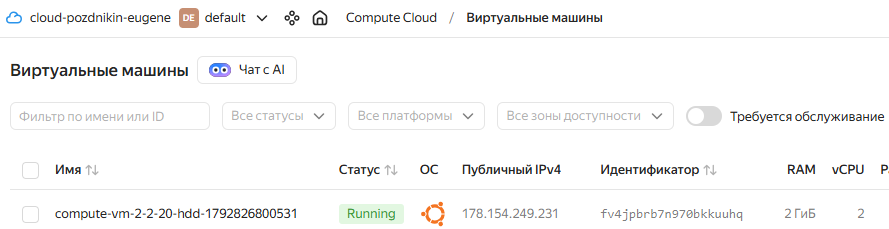

Запускаю скрипт 

```
./app.sh
```
Проверяю на сервере
```
curl -L http://127.0.0.1:8090
```
Вывод консоли
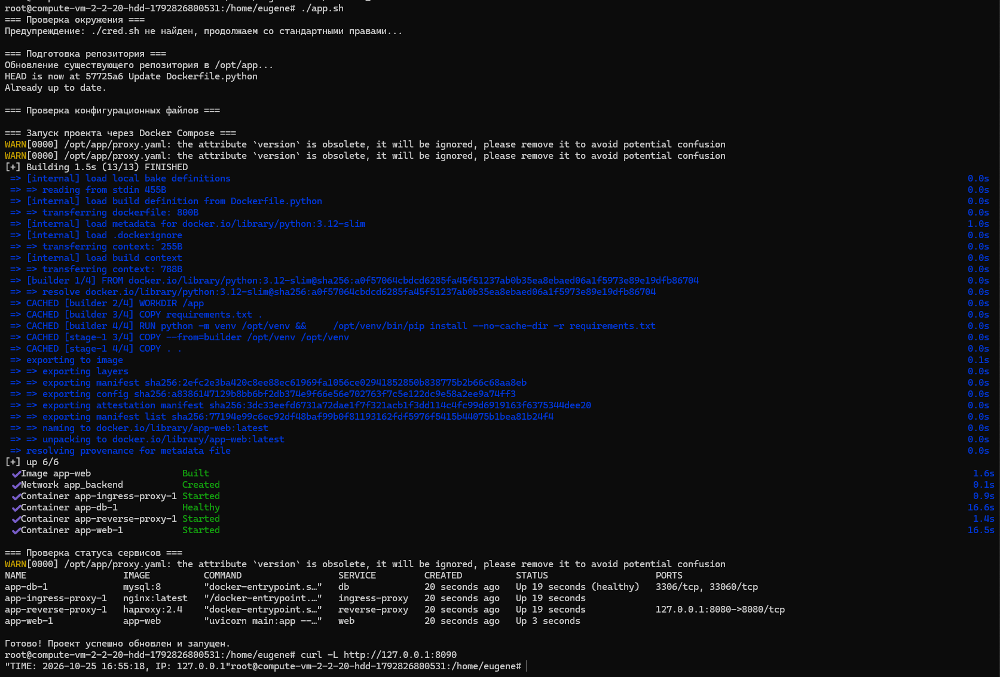

Захожу на сайт проверки `https://check-host.net/check-http` b и указываю свой адрес `http://178.154.249.231:8090/`
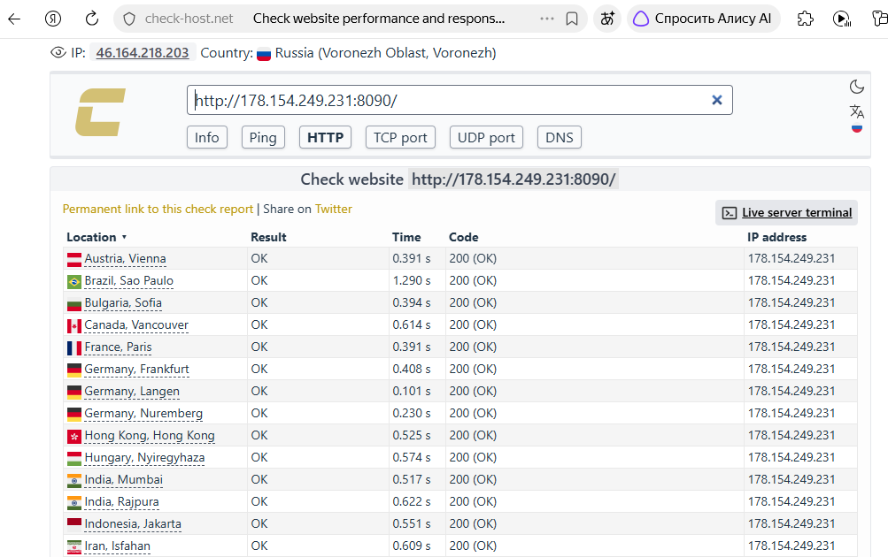

Проверяю содержимое базы

```
docker exec -ti app-db-1 sh -c 'mysql -uroot -p"$MYSQL_ROOT_PASSWORD" -e "USE virtd; SELECT * FROM requests LIMIT 10;"'
```
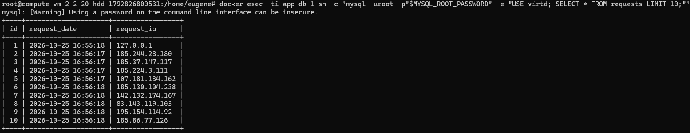

[Ссылка на fork](https://github.com/PozdnikinEugene/05-virt-04-docker-in-practice-fork.git)

### Задание 6
Запускаю `dive hashicorp/terraform:latest` 

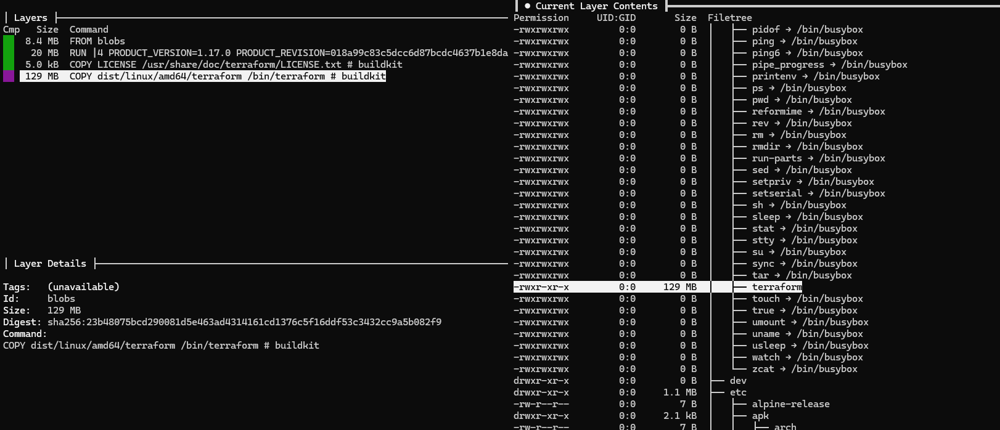

В зависимости от формата хранения Docker структура каталогов может различаться. Обычно tar-архив слоя находится в подкаталоге с именем, соответствующим ID слоя (или в blobs/sha256/, если используется формат OCI).

- Если структура старая (именованные каталоги): войдите в каталог, имя которого совпадает с ID слоя, найденным на шаге 2 (ID может быть усечён), и распакуйте находящийся там layer.tar.

- Если структура OCI (blobs): tar-файл слоя может находиться в blobs/sha256/, имя файла может не совпадать с ID, отображаемым в dive (потому что dive показывает chainID или дифф-ID). В этом случае проще всего использовать grep или find для перебора всех файлов слоёв и поиска файла, содержащего bin/terraform.

У меня слой `Digest: sha256:23b48075bcd290081d5e463ad4314161cd1376c5f16ddf53c3432cc9a5b082f9` и он не совпадает с содержимым слоев образа.


 ```
root@compute-vm-2-2-20-hdd-1792826800531:/home/eugene# docker save -o terraform-image.tar hashicorp/terraform:latest
root@compute-vm-2-2-20-hdd-1792826800531:/home/eugene# mkdir -p terraform-extract
root@compute-vm-2-2-20-hdd-1792826800531:/home/eugene# tar -xf terraform-image.tar -C terraform-extract
root@compute-vm-2-2-20-hdd-1792826800531:/home/eugene# ls -lah terraform-extract/blobs/sha256/
total 51M
drwxr-xr-x 2 root root 4.0K Jan  1  1970 .
drwxr-xr-x 3 root root 4.0K Jan  1  1970 ..
-r--r--r-- 1 root root 2.1K Jan  1  1970 35b935f050741b78388e7c1886042712e181eaebac8d4338fc1a0f14bb7c705f
-r--r--r-- 1 root root 1.2K Jan  1  1970 4d1b496a256f2989bccdb04b9104a4ede97234b10fba90259e173e905ec4fb58
-r--r--r-- 1 root root 3.8M Jan  1  1970 4fdc56a1d49fc749f4b6d53e468a046cd1a019e7b108b1e5c954a43548e3997d
-r--r--r-- 1 root root  38M Jan  1  1970 8849370588e7f05c63a1a5b4cbaa50170be2876b00f7da05a6b9d17fe3d4f654
-r--r--r-- 1 root root  918 Jan  1  1970 a73003e3006f4e64e9da0b4362011250b09f096f9a27261435aff45bd54e2d63
-r--r--r-- 1 root root 4.2K Jan  1  1970 abe496ffdc71367ed111b951e67566d8cf82e15278a78c8ddcb4c7b95a885f82
-r--r--r-- 1 root root 9.2M Jan  1  1970 ea85abb46697a3476962322431521a37c447c0a453d7447e1b1bfd3f3f2fdce3
``` 
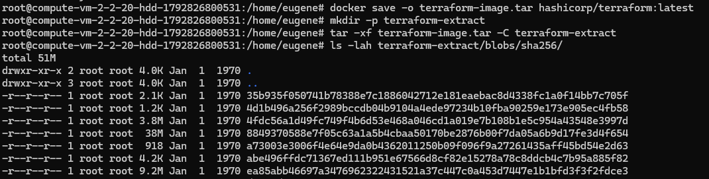 

Поскольку dive показывает ID как blobs, мы не можем просто зайти в папку по имени. Нам нужно распаковать все блобы и найти файл.
Распаковываем все слои в одну папку 

```
mkdir -p extracted
for f in blobs/sha256/*; do
  tar -xf "$f" -C extracted 2>/dev/null
done
```
Ищем файл,  копируем его на уровень выше и возвращаемся в домашнюю директорию

```
find extracted -name terraform -type f
cp extracted/bin/terraform ../terraform
cd ..
```
Делаем исполняемым (на всякий случай) Проверяем тип файла и запускаем
```
chmod +x terraform
file terraform
 ./terraform version
```

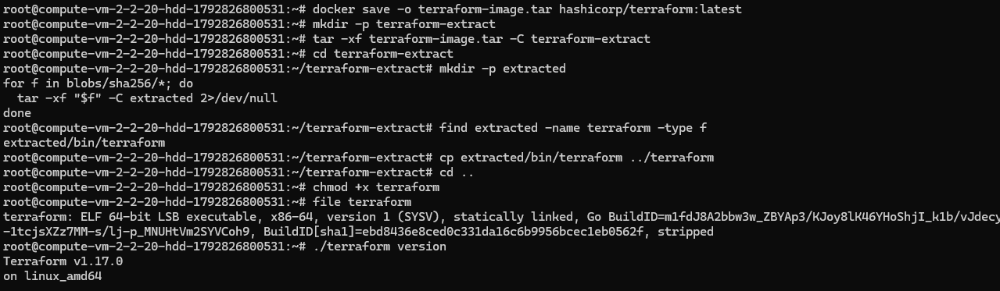

